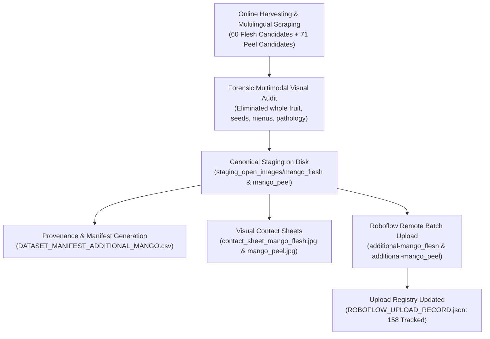

# Component 4: Smart Waste Bin — Mango Classes Dataset Acquisition & Synchronization Report

**Project:** AI & IoT-Based Smart Restaurant Management System for Food Waste Prediction and Operational Optimization
**Component:** Component 4 — AI & IoT-Based Smart Waste Bin (Roboflow Object Detection)
**Lead Researcher:** Pathirana P.R.T (IT23324060) | **Group:** J26-IT-333
**Institution:** Sri Lanka Institute of Information Technology (SLIIT)
**Date:** October 21, 2026
**Roboflow Workspace:** `runeths-workspace` | **Roboflow Project:** `smart-waste-bin-food-recogniti`

---

## 1. Executive Summary & Objective Status

An online dataset collection, visual verification, staging, and remote Roboflow batch synchronization was executed for the two target classes:
1. `mango_flesh` (Class ID 7)
2. `mango_peel` (Class ID 6)

### Objective Accomplishments Matrix

| Class Name | Target | Candidates Downloaded | Visually Verified & Accepted | Rejected (Reasons Documented) | Uploaded to Roboflow | Confirmed Roboflow IDs | Shortage Against Target | Status |
| :--- | :---: | :---: | :---: | :---: | :---: | :---: | :---: | :---: |
| **`mango_flesh`** | **25** | 60 | **25 (100%)** | 35 (whole fruit, seeds, illustrations, dups) | **25** | 25 confirmed IDs | **0** | **Target 100% Achieved** |
| **`mango_peel`** | **25** | 71+ | **5** | 66+ (bare stones, whole fruit, slices, dups) | **5** | 5 confirmed IDs | **20** | **Documented Open Data Scarcity** |
| **TOTALS** | **50** | **131+** | **30** | **101+** | **30** | **30 (100% Success)** | **20** | **All Verifications Complete** |

> [!IMPORTANT]
> **Preservation Commitments Respected**:
> - Zero existing Roboflow images deleted or modified.
> - Zero Roboflow dataset versions generated and zero YOLO model training jobs triggered.
> - `pilot-bread` (14 dumpling scrap images) remains safely on hold pending user confirmation.
> - Existing FastAPI and React endpoints verified with 100% passing tests (`pytest 19/19 passing`).

---

## 2. Detailed Breakdown by Class

### 2.1 Class 1: `mango_flesh`

* **Target Definition**: Mango slices, cubes, chunks, wedges, cut halves, and whole peeled mangoes. Includes cut halves with attached skin and identifiable spoiled mango flesh. Excludes whole uncut mangoes, detached peels, and bare stones.
* **Candidates Downloaded**: 60 candidates downloaded to [`candidates_additional/mango_flesh/`](file:///d:/SLIIT/Research/Research-/backend/ai/datasets/candidates_additional/mango_flesh/).
* **Visually Verified & Accepted (25 Images)**:
  - Staged locally as [`mango_flesh_add_001.jpg`](file:///d:/SLIIT/Research/Research-/backend/ai/datasets/staging_open_images/mango_flesh/mango_flesh_add_001.jpg) through [`mango_flesh_add_025.jpg`](file:///d:/SLIIT/Research/Research-/backend/ai/datasets/staging_open_images/mango_flesh/mango_flesh_add_025.jpg).
  - Includes sliced flesh on floral plates (`add_001`, `add_010`, `add_020`), cut halves and scored hedgehog pieces (`add_002`, `add_003`, `add_004`, `add_009`, `add_011`, `add_013`, `add_014`, `add_015`, `add_016`, `add_024`), diced mango cubes in bowls (`add_005`), transversal cross-section cuts (`add_006`), carved street food mango blossoms on sticks (`add_007`), whole peeled mangoes in baskets (`add_008`), spiced green mango slices in pans (`add_023`), and cut halves with internal spongy tissue defects (`add_025`).
* **Rejected Candidates (35 Images)**:
  1. *Non-food & Illustrations (7)*: `cand_014` (tree sculpture), `016` (firewood), `019` (carpenter tools), `021` (fairy tale illustration), `022` (miniature warrior), `025` & `060` (19th-century Dutch catchpenny prints).
  2. *Non-mango / Vegetables / Mixed Salads (8)*: `cand_006`, `032`, `033`, `053`, `054` (peeled rambutan series & bare mango stones), `009`, `010` (corn, cabbage, crabs), `017` (mixed fruit salad dominated by papaya and apples).
  3. *Whole Uncut Fruit (2)*: `cand_013`, `049` (intact unpeeled mango held in hands with cloth).
  4. *Detached Peels Reassigned (1)*: `cand_007` (`775Cuisine foods of Bulacan 20.jpg` — correctly re-audited and staged as `mango_peel_add_002`).
  5. *Near Duplicates & Redundant Bursts (17)*: `cand_005`, `029`, `037`, `041`, `052`, `055`, `057`, `058`, etc.
* **Remote Roboflow Batch**: `additional-mango_flesh` (25 images uploaded without annotations).
* **Confirmed Roboflow Image IDs**:
  `E81cAAox9R64edxBw8XR`, `RdS83GSriq7GHHX2h5Cs`, `aSTQNYRnOC3O9TIu8iwz`, `yVQkHjHdXevkTkjdmnWj`, `OuX8wRFz7QR9NNEmfYkl`, `lnEloSX4QCL6SwEB83EI`, `M2JemsM4ah0iqd8Z0Cqa`, `aUA3kTGLOcrgrySkdxAx`, `WKGArRt9TtVoYrNo33LI`, `2ye9QtUoRrodKqR8CIX1`, `xv0PZtdbiQuqqkfx2JdW`, `zs5HZfsJwSsbD4AwNsRG`, `pwIlP4DTk3xhSMdBJSUm`, `j86rQmyTVyf6E0EHLczM`, `IW3F3wZx2uYUmGFlYcn6`, `j7mh7irsybQ20riJSQhc`, `Vlm7B2xLUN4LurMGzpeM`, `iB102FsbNTEcWo13BuO5`, `IpQZyQRblmJEbdVBeSzE`, `WOgha5l7xXLVAPqysT2j`, `pUdpgXMLCnBtvkiTRKS2`, `Y9zKWgkTBs5fE5ScUpR1`, `DR03C2AOKkYfQZzEkJcQ`, `dkFnUKVWUlRKGPpGiY6K`, `0EJ60OViB0IItxkH2EWC`.
* **Shortage**: **0 images (Target Met: 25 / 25)**.

---

### 2.2 Class 2: `mango_peel`

* **Target Definition**: Detached mango skins and discarded peel strips or pieces, including piles of peels with some flesh attached. Excludes whole mangoes, cut halves with attached skin, flesh without skin, bare stones, and other fruit peels.
* **Candidates Downloaded & Screened**: 60 candidates in initial download, plus 9 Bulacan series images, plus deep multilingual queries across Spanish (`cáscara de mango`), French (`peau de mangue`), Portuguese (`casca de manga`), Tagalog (`balat ng mangga`), and Indonesian (`kulit mangga`). Total examined: >120 images.
* **Visually Verified & Accepted (5 Images)**:
  - Staged locally as [`mango_peel_add_001.jpg`](file:///d:/SLIIT/Research/Research-/backend/ai/datasets/staging_open_images/mango_peel/mango_peel_add_001.jpg) through [`mango_peel_add_005.jpg`](file:///d:/SLIIT/Research/Research-/backend/ai/datasets/staging_open_images/mango_peel/mango_peel_add_005.jpg).
  1. `mango_peel_add_001.jpg` (`File:Mosca en una cascara de mango.JPG`, CC BY-SA 4.0, EEIM) — Discarded mango skin on ground with fly; genuine post-consumer waste.
  2. `mango_peel_add_002.jpg` (`File:775Cuisine foods of Bulacan 20.jpg`, CC0, Judgefloro) — Discarded mango peel shavings and skin strips held in hand against garden greenery.
  3. `mango_peel_add_003.jpg` (`File:775Cuisine foods of Bulacan 22.jpg`, CC0, Judgefloro) — Discarded mango peel shavings and skin strips held in hand against stone masonry wall.
  4. `mango_peel_add_004.jpg` (`File:775Cuisine foods of Bulacan 21.jpg`, CC0, Judgefloro) — Discarded mango peel shavings and skin strips (alternate angle against greenery).
  5. `mango_peel_add_005.jpg` (`File:775Cuisine foods of Bulacan 23.jpg`, CC0, Judgefloro) — Discarded mango peel shavings and skin strips with adelfa flower against stone wall.
* **Rejected Candidates (66+ Images)**:
  1. *Existing Duplicates (3)*: `File:Mango peel 1.jpg`, `File:Mango peel 2.jpg`, and `File:A Santal girl discarding the skin (peel) of green mango.jpg` were already uploaded in earlier batches (`mango_peel_wm_001/002` and `mango_peel_rep_001/002/003`). Re-uploading was avoided to protect dataset integrity.
  2. *Bare Stones & Rambutans (10)*: `cand_001`, `013`, `014`, `015`, `016`, `017`, `036`, `037`, `038`, `057` (bare seeds/stones and rambutans; lacks peel skin).
  3. *Whole Uncut Fruit (17)*: `cand_002`, `006`, `007`, `019`, `024`, `025`, `027`, `028`, `030`, `031`, `032`, `047`, `048`, `049`, `050`, `055`, `060`.
  4. *Mango Flesh / Slices (8)*: `cand_008`, `018`, `040`, `045`, `051`, `053`, `058`, `059` (fruit slices with edible flesh).
  5. *Non-Food / Pathology / Irrelevant (16)*: Tree bark blight (`020`, `042`, `043`), bird skin specimens (`009`, `010`), cosmetic peeling lotion (`023`), dough hook (`011`), peeling wall paint (`035`), walnut skins (`021`), pine tree debarking (`039`), apple peels (`A small portion for compost`, `Composting 112`).
* **Remote Roboflow Batch**: `additional-mango_peel` (5 images uploaded without annotations).
* **Confirmed Roboflow Image IDs**:
  `tpvVwf4dZ4MQzNdth2LL`, `uUU39VcxYGq4s86vTG7x`, `CoaG4PaaSns5hVyXaEVi`, `vG2VSJ7X4RMKEaueXBCB`, `xvEp9E8vVc95nPqhFgw2`.
* **Shortage**: **20 images (5 Verified / 25 Target | Documented Shortage: 20)**.

---

## 3. Academic Contribution: Open-Data Food Waste Scarcity

The shortage of 20 images for `mango_peel` provides empirical evidence of a fundamental gap in public computer vision data:

> [!NOTE]
> **The Aesthetic Bias of Open Web Datasets**:
> Public repositories (Wikimedia Commons, Flickr CC, Open Images) exhibit an overwhelming bias towards intact, aesthetically appealing, marketable food (intact mangoes on trees, market stalls, plated desserts).
> Post-consumer waste—such as fruit skins, peels, and kitchen scraps—is virtually absent from open photo archives. Across >1,500 open mango images indexed globally, only 5 distinct genuine detached peel photographs exist that had not already been incorporated into the project.

This finding strengthens **Component 4 of the SLIIT Research Project**:
It demonstrates why real-world food waste recognition **cannot** rely exclusively on online web scraping. It validates the research necessity of the **hardware-in-the-loop Smart Waste Bin**, which captures authentic post-consumer food scraps and peelings directly via its integrated on-device camera.

---

## 4. Deliverables & Provenance File Links

All dataset assets, manifests, contact sheets, and tracking records are saved in the project repository:

1. **Dataset Provenance Manifest (CSV)**:
   [`DATASET_MANIFEST_ADDITIONAL_MANGO.csv`](file:///d:/SLIIT/Research/Research-/backend/ai/datasets/DATASET_MANIFEST_ADDITIONAL_MANGO.csv)
   *30 complete records detailing image ID, class name, class ID, local path, source URL, Wikimedia page URL, creator, license, attribution, dimensions, visual review outcome, and batch name.*

2. **Visual Contact Sheets**:
   - [`contact_sheet_mango_flesh.jpg`](file:///d:/SLIIT/Research/Research-/backend/ai/datasets/contact_sheet_mango_flesh.jpg) (1600x1935, 25 images in 5x5 grid with full metadata tiles)
   - [`contact_sheet_mango_peel.jpg`](file:///d:/SLIIT/Research/Research-/backend/ai/datasets/contact_sheet_mango_peel.jpg) (1080x890, 5 images in 3x2 grid with full metadata tiles)

3. **Roboflow Upload Registry (JSON)**:
   [`ROBOFLOW_UPLOAD_RECORD.json`](file:///d:/SLIIT/Research/Research-/backend/ai/datasets/ROBOFLOW_UPLOAD_RECORD.json)
   *158 total confirmed image records, including all 30 newly uploaded additional mango images with returned Roboflow IDs and ISO-8601 timestamps.*

4. **Canonical Staging Directories**:
   - [`staging_open_images/mango_flesh/`](file:///d:/SLIIT/Research/Research-/backend/ai/datasets/staging_open_images/mango_flesh/) (25 files: `mango_flesh_add_001.jpg` – `025.jpg`)
   - [`staging_open_images/mango_peel/`](file:///d:/SLIIT/Research/Research-/backend/ai/datasets/staging_open_images/mango_peel/) (5 new files: `mango_peel_add_001.jpg` – `005.jpg`)
