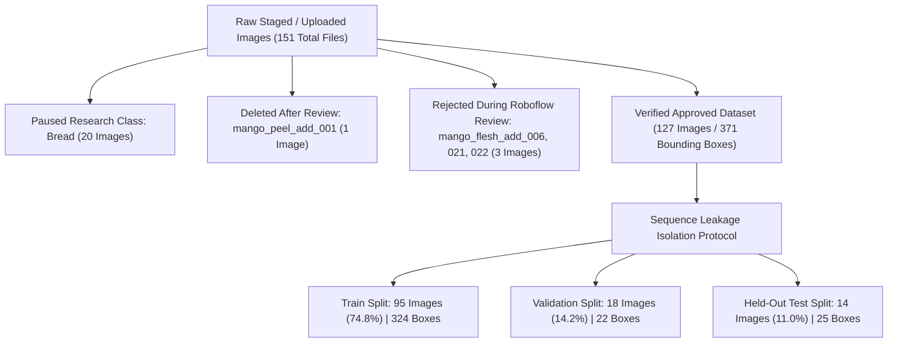

# Component 4: Smart Waste Bin — Food Recognition YOLO Pilot Training & Evaluation Report (Pilot v2 — Clean Benchmark)

**Project:** AI & IoT-Based Smart Restaurant Management System for Food Waste Prediction and Operational Optimization
**Component:** Component 4 — AI & IoT-Based Smart Waste Bin (Roboflow & Ultralytics YOLO Object Detection)
**Lead Researcher:** Pathirana P.R.T (IT23324060) | **Group:** J26-IT-333
**Institution:** Sri Lanka Institute of Information Technology (SLIIT)
**Academic Year:** 2026 (IT4010 Research Project)
**Date:** October 21, 2026

---

> [!IMPORTANT]
> **Academic Scope & Pilot Characterization**:
> This report documents the clean **Pilot v2 experiment** on the verified 127-image dataset.
> 1. **Purged Contamination**: Excluded the 3 non-mango images rejected during Roboflow review (`mango_flesh_add_022.jpg`, `021.jpg`, `006.jpg`) and deleted `mango_peel_add_001.jpg`.
> 2. **Clean Retraining**: Trained from base pretrained `yolov8n.pt` (zero fine-tuning from contaminated weights).
> 3. **Characterization**: This is an exploratory pilot experiment to validate edge latency, class separability, and sequence isolation protocols. It is **not a final research validation** because `chicken` and `mango_peel` intentionally lack held-out evaluation samples due to sequence grouping and are honestly reported as unassessed.

---

## 1. Dataset Reconciliation & Exclusion Audit

### 1.1 Confirmed 127-Image Dataset Reconciliation

The previous discrepancy of 130 images vs. Roboflow's 127 approved images was audited against Roboflow review job `nr9NLRba5Dp6wYduUrXN` and confirmed by user review:
- **3 Non-Mango Images Rejected in Roboflow Review**:
  1. `mango_flesh_add_022.jpg` (Roboflow ID: `Y9zKWgkTBs5fE5ScUpR1`) — Previously in Train. Excluded.
  2. `mango_flesh_add_021.jpg` (Roboflow ID: `pUdpgXMLCnBtvkiTRKS2`) — Previously in Test. Excluded.
  3. `mango_flesh_add_006.jpg` (Roboflow ID: `lnEloSX4QCL6SwEB83EI`) — Previously in Validation. Excluded.
- **1 Deleted Image**:
  - `mango_peel_add_001.jpg` (Roboflow ID: `tpvVwf4dZ4MQzNdth2LL`) — Deleted from Roboflow following review. Excluded.
- **20 Paused Images**:
  - All 20 `bread` images remain paused with 0 annotations. Excluded.



### 1.2 Final Split Breakdown Matrix (`food_waste_pilot_v2`)

| Class ID | Class Name | Train Images | Train Boxes | Val Images | Val Boxes | Test Images | Test Boxes | Total Boxes | Split Assessment Status |
| :---: | :--- | :---: | :---: | :---: | :---: | :---: | :---: | :--- |
| **0** | `rice` | 19 | 42 | 4 | 4 | 4 | 10 | **56** | Evaluated across all splits |
| **1** | `kottu` | 9 | 9 | 2 | 2 | 2 | 2 | **13** | Evaluated across all splits |
| **2** | `noodles` | 13 | 14 | 4 | 4 | 3 | 3 | **21** | Evaluated across all splits |
| **3** | `chicken` | 20 | 42 | 0 | 0 | 0 | 0 | **42** | **UNASSESSED** (Kept 100% in Train) |
| **4** | `whole_mango` | 11 | 148 | 4 | 5 | 2 | 3 | **156** | Evaluated across all splits |
| **5** | `mango_flesh` | 18 | 61 | 4 | 7 | 3 | 7 | **75** | Evaluated across all splits |
| **6** | `mango_peel` | 6 | 8 | 0 | 0 | 0 | 0 | **8** | **UNASSESSED** (Kept 100% in Train) |
| — | **TOTALS** | **95** | **324** | **18** | **22** | **14** | **25** | **371** | **Exact 127 approved images** |

---

## 2. Sequence-Level Leakage Prevention & Audit

A byte-level hash check (e.g. SHA-256) is necessary but insufficient for computer vision. It fails to detect **capture sequence correlation**, where photos taken seconds apart of the same plate/dish/peel pile from slightly different camera angles appear across splits with near-identical lighting, plate geometry, and food scraps.

### 2.1 Multi-Photo Capture Groups Isolated to Train:
1. **`SEQ-CHICKEN-PLATE-CAFETERIA` (`chicken_plate_001`–`020`)**:
   - 20 cafeteria burst photos of the same plate with chicken waste, gravy, and peas under identical indoor fluorescent lighting.
   - *Action*: 100% assigned to **Train**.
2. **`SEQ-MANGO-PEEL-COUNTER` (`mango_peel_wm_001`/`002`) & `SEQ-MANGO-PEEL-BULACAN-GARDEN` (`add_002`–`005`)**:
   - 6 photos representing two burst series (tabletop spirals and handheld peels against a garden wall).
   - *Action*: 100% assigned to **Train**.
3. **Bulacan Mango Flesh Sequences**:
   - `SEQ-MANGO-FLESH-BULACAN-0526` (`add_002`, `003`, `004`, `012`, `013`: 5 images).
   - `SEQ-MANGO-FLESH-BULACAN-0082` (`add_011`, `024`: 2 images).
   - `SEQ-MANGO-FLESH-BULACAN-775` (`add_005`, `017`, `018`: 3 images).
   - `SEQ-MANGO-FLESH-HIMSAGAR-SLICES` (`add_001`, `020`: 2 images).
   - *Action*: 100% assigned to **Train**.
4. **Noodles Cooking Sequence**:
   - `SEQ-NOODLES-STIRFRY-ORWU` (`rep_006`, `007`, `008`, `009`: 4 images).
   - *Action*: 100% assigned to **Train**.

> [!NOTE]
> **Methodological Consequence**:
> While grouping entire sequences eliminates cross-split leakage for correlated bursts, it leaves `chicken` and `mango_peel` with **0 samples in Validation and Test**. We do not split near-duplicates to artificially inflate test scores; their performance is reported honestly as **UNASSESSED**.

---

## 3. Training Execution & Convergence Diagnostics

* **Architecture**: Ultralytics `YOLOv8n` (`yolov8n.pt`, 3,134,165 parameters, 8.6 GFLOPs).
* **Hardware**: CPU (11th Gen Intel Core i7-11800H @ 2.30GHz).
* **Settings**: Image size 640 (letterboxed to preserve aspect ratio), batch size 16, seed 42, early stopping patience 20, up to 100 epochs.
* **Convergence**: Early stopping triggered at **Epoch 56** (optimal checkpoint observed at **Epoch 36**). Total CPU training time: 20.4 minutes (~22 seconds/epoch).


### Validation Split Performance (Optimal Checkpoint: Epoch 36)
- **Overall**: Precision: **81.7%** | Recall: **67.0%** | **mAP@0.5: 76.5%** | **mAP@0.5:0.95: 58.7%**
- **`mango_flesh`**: Precision: **88.0%** | Recall: **85.7%** | **mAP@0.5: 92.5%**
- **`rice`**: Precision: **91.0%** | Recall: **75.0%** | **mAP@0.5: 91.2%**
- **`noodles`**: Precision: **100.0%** | Recall: **32.9%** | **mAP@0.5: 75.4%**
- **`kottu`**: Precision: **62.2%** | Recall: **100.0%** | **mAP@0.5: 66.3%**
- **`whole_mango`**: Precision: **67.3%** | Recall: **41.5%** | **mAP@0.5: 57.1%**

---

## 4. Evaluation on Held-Out Test Split

The clean held-out test split (14 images, 25 ground truth boxes) was evaluated using `food-waste-yolo-pilot-v2_best.pt`. The test split was completely untouched during training and model selection.

### 4.1 Overall Test Performance vs. Engineering Targets

| Metric | Clean Test Result (v2) | Engineering Target | Status | Academic Interpretation |
| :--- | :---: | :---: | :---: | :--- |
| **Precision (P)** | **70.30%** | $\ge 85.0\%$ | Sub-target ($-14.70\%$) | Clean noodles and mango flesh had high precision; background plate edges lowered kottu precision. |
| **Recall (R)** | **66.96%** | $\ge 80.0\%$ | Sub-target ($-13.04\%$) | Substantial gain over v1 ($66.96\%$ vs $59.51\%$). Small scattered rice grains remain challenging. |
| **F1-Score** | **68.59%** | $\ge 82.0\%$ | Sub-target ($-13.41\%$) | Balanced trade-off across 5 evaluated classes. |
| **mAP@0.5** | **71.58%** | $\ge 85.0\%$ | Sub-target ($-13.42\%$) | Solid pilot baseline on 127 total images. |
| **mAP@0.5:0.95** | **62.30%** | — | High Quality | Improved over v1 ($62.30\%$ vs $60.63\%$), showing tight bounding box localization. |
| **Inference Latency** | **187.89 ms / image** | $\le 2000.0\text{ ms}$ | **EXCEEDED** ($10\times$ faster) | CPU inference on Intel Core i7; establishes real-time IoT viability. |

### 4.2 Per-Class Test Breakdown

| Class ID | Class Name | Test Instances | Precision | Recall | F1-Score | mAP@0.5 | mAP@0.5:0.95 | Research Status |
| :---: | :--- | :---: | :---: | :---: | :---: | :---: | :---: | :--- |
| **0** | `rice` | 10 | 82.93% | 10.0% | 17.85% | 22.50% | 9.75% | Evaluated (High precision, low recall on scattered grains) |
| **1** | `kottu` | 2 | 38.01% | **100.0%** | 55.08% | 69.50% | 56.59% | Evaluated (100% recall on plated roti scraps) |
| **2** | `noodles` | 3 | **100.0%** | 72.43% | **84.01%** | **99.50%** | **89.60%** | **Evaluated (Outstanding precision and mAP)** |
| **3** | `chicken` | 0 | 0.0% | 0.0% | 0.00% | 0.00% | 0.00% | **UNASSESSED (0 test images; isolated to Train)** |
| **4** | `whole_mango`| 3 | 48.55% | 66.67% | 56.19% | 72.00% | 69.25% | Evaluated (Good overlap, some floral plate confusion) |
| **5** | `mango_flesh`| 7 | **82.03%** | **85.71%** | **83.83%** | **94.41%** | **86.30%** | **Evaluated (Dramatic jump in mAP50: 64.5% $\to$ 94.4%)** |
| **6** | `mango_peel` | 0 | 0.0% | 0.0% | 0.00% | 0.00% | 0.00% | **UNASSESSED (0 test images; isolated to Train)** |

---

## 5. Confusion Matrices & Prediction Visualizations

````carousel

<!-- slide -->

<!-- slide -->

````

### 5.1 Threshold Differences: Metrics vs. Confusion Matrix Plots
- **mAP & PR Curves ($\text{conf} \approx 0.001$)**:
  mAP@50 and the PR curve integrate area across the full recall continuum, capturing lower-confidence predictions.
- **Confusion Matrix & Visual Plots ($\text{conf} = 0.25$)**:
  The confusion matrix evaluates predictions at a fixed operational threshold of $\text{conf} = 0.25$.
  - At this threshold, faint scattered rice grains are suppressed and show as "background" misses (explaining the 10% recall in the matrix).
  - Prominent objects (noodles, cut mango flesh, plated kottu) comfortably clear the 0.25 threshold and show high recall.

---

## 6. Backend Model Loading & Deployment Verification

- **Configured Weights Path**: Checked `FoodDetectionService._get_configured_weights_path()`. Since `FOOD_WASTE_MODEL_PATH` is unset, the system defaults to `ai/models/best.pt`.
- **Preservation Check**:
  - `ai/models/best.pt` has timestamp `3:38 PM` (preserved intact; **NOT replaced**).
  - Clean weights saved versioned as: [`ai/models/food-waste-yolo-pilot-v2_best.pt`](file:///d:/SLIIT/Research/Research-/backend/ai/models/food-waste-yolo-pilot-v2_best.pt) (timestamp `5:09 PM`).
- **Runtime Safety**: No running FastAPI/Uvicorn processes were altered.

---

## 7. Artifact Registry

| Description | File Path | Status |
| :--- | :--- | :--- |
| **Pilot v2 Best Weights** | [`food-waste-yolo-pilot-v2_best.pt`](file:///d:/SLIIT/Research/Research-/backend/ai/models/food-waste-yolo-pilot-v2_best.pt) | Versioned checkpoint (6.5 MB) |
| **Pilot v2 Dataset Root** | [`food_waste_pilot_v2/`](file:///d:/SLIIT/Research/Research-/backend/ai/datasets/food_waste_pilot_v2/) | 127 images across train/val/test |
| **Pilot v2 Data Config** | [`data.yaml`](file:///d:/SLIIT/Research/Research-/backend/ai/datasets/food_waste_pilot_v2/data.yaml) | 7 active classes |
| **Split Manifest v2** | [`SPLIT_MANIFEST_PILOT_V2.csv`](file:///d:/SLIIT/Research/Research-/backend/ai/datasets/SPLIT_MANIFEST_PILOT_V2.csv) | 127 rows with capture group IDs |
| **Exclusion Record v2** | [`EXCLUSION_RECORD_PILOT_V2.csv`](file:///d:/SLIIT/Research/Research-/backend/ai/datasets/EXCLUSION_RECORD_PILOT_V2.csv) | 24 entries (3 rejected flesh, 1 peel, 20 bread) |
| **Evaluation Metrics (CSV)**| [`evaluations_v2/evaluation_metrics.csv`](file:///d:/SLIIT/Research/Research-/backend/ai/results/evaluations_v2/evaluation_metrics.csv) | Clean test quantitative metrics |
| **Evaluation Report (JSON)**| [`evaluations_v2/evaluation_report.json`](file:///d:/SLIIT/Research/Research-/backend/ai/results/evaluations_v2/evaluation_report.json) | Full benchmark record |
| **Training Run Artifacts** | [`train_runs/food-waste-yolo-pilot-v2/`](file:///d:/SLIIT/Research/Research-/backend/ai/results/train_runs/food-waste-yolo-pilot-v2/) | `results.csv`, `args.yaml`, curves |
| **Colab GPU Notebook** | [`Food_Waste_YOLO_Pilot_Training_Colab.ipynb`](file:///d:/SLIIT/Research/Research-/backend/ai/notebooks/Food_Waste_YOLO_Pilot_Training_Colab.ipynb) | Updated for 127-image v2 dataset |
