# ESP32-CAM Hardware Setup & Circuit Integration Guide
## Component 3: Computer Vision Optical Food Container Inspection
**Researcher**: Maddumage M. S. (IT23348820)  
**Project**: AI & IoT-Based Smart Restaurant Management System (`J26-IT-333`)  
**Institution**: Sri Lanka Institute of Information Technology (SLIIT) - Faculty of Computing  

---

## 1. Hardware Architecture Overview

In Component 3, the **AI-Thinker ESP32-CAM** acts as an edge optical inspection node mounted inside food containers, produce crispers, or walk-in fruit chillers. It captures photographic frames of fresh produce with automated flash illumination and streams high-definition snapshots over Wi-Fi directly to the FastAPI Computer Vision backend.

```mermaid
flowchart LR
    subgraph ColdStorage["Food Storage Container / Cold Chamber"]
        Produce["Fresh / Expiring Produce\n(Fruits & Vegetables)"]
        Flash["Onboard Flash LED (GPIO 4)"]
        Cam["OV2640 Optical Sensor"]
    end

    subgraph EdgeNode["AI-Thinker ESP32-CAM Node"]
        MCU["ESP32 Dual-Core (240 MHz)"]
        PSRAM["4MB External PSRAM"]
        WiFi["Wi-Fi 802.11 b/g/n (Port 80)"]
    end

    subgraph BackendSystem["Central AI Analytics Server"]
        PullEndpoint["POST /api/vision/esp32/capture"]
        PushEndpoint["POST /api/vision/esp32/upload"]
        CVEngine["Computer Vision Multi-Task Engine\n(Produce ID, Ripeness, Spoilage, RSL)"]
    end

    subgraph UserInterface["React Web Dashboard"]
        LiveUI["Container Optical Scanner & Ripeness Assessor"]
        Overlays["Real-Time Bounding Boxes & RSL Countdown"]
    end

    Produce -.->|Reflected Light| Cam
    Flash -.->|Timed Illumination| Produce
    Cam -->|Parallel DVP Bus| MCU
    MCU -->|JPEG Buffer| WiFi
    WiFi -->|HTTP Stream /capture| PullEndpoint
    PullEndpoint --> CVEngine
    CVEngine --> LiveUI
    LiveUI --> Overlays
```



---

## 2. Hardware Bill of Materials (BOM)

| Item | Component | Specification | Function |
| :--- | :--- | :--- | :--- |
| **1** | **ESP32-CAM Development Board** | AI-Thinker Module with OV2640 Camera | Edge camera processing and Wi-Fi transmission |
| **2** | **Camera Sensor** | OV2640 (2 Megapixel, 160° or 66° lens) | Captures JPEG color frames of produce |
| **3** | **USB-to-TTL UART Programmer** | FT232RL FTDI or CP2102 | Flashes firmware and serial debugging via USB |
| **4** | **Jumper Wire for Flash Mode** | Female-to-Female Jumper | Connects GPIO 0 to GND during bootloader flashing |
| **5** | **External Power Supply** | 5V DC 2.0A (or USB 5V 2A) | Powers camera module (camera peaks at ~310mA during flash) |

> [!IMPORTANT]
> The ESP32-CAM requires a stable **5V power supply with at least 1.5A - 2.0A capacity**. Powering the module purely from weak 3.3V or unpowered USB hubs can cause "Brownout detector was triggered" camera reboots.

---

## 3. FTDI USB-to-TTL Flashing Circuit Wiring

Because the ESP32-CAM does not possess an onboard USB port, connect it to your computer using an FTDI USB-to-TTL adapter:

```
+-------------------+                      +-------------------+
|     FTDI USB      |                      |     ESP32-CAM     |
|   Serial Adapter  |                      |     AI-Thinker    |
|                   |                      |                   |
|       5V (VCC)    |--------------------->| 5V                |
|       GND         |--------------------->| GND               |
|       TXD         |--------------------->| U0R (GPIO 3 - RX) |
|       RXD         |<---------------------| U0T (GPIO 1 - TX) |
|                   |                      |                   |
|                   |                      | GPIO 0 --------+  |
|                   |                      |                |  |
|                   |                      | GND -----------+  |
+-------------------+                      +-------------------+
                                            (Bridge for FLASH)
```

### Complete Pin Connection Matrix

| FTDI Pin | ESP32-CAM Pin | Color Guide | Purpose |
| :--- | :--- | :--- | :--- |
| **VCC (5V)** | **5V** | Red | Power input |
| **GND** | **GND** | Black | Ground reference |
| **TXD** | **U0R (GPIO 3)** | Yellow / White | Serial Data Receive |
| **RXD** | **U0T (GPIO 1)** | Green / Blue | Serial Data Transmit |
| *N/A* | **GPIO 0 to GND** | Jumper wire | **Bridged ONLY during flashing** (disconnect to run) |

---

## 4. Arduino IDE Setup & Configuration

1. **Install ESP32 Board Package**:
   - Open **Arduino IDE** $\rightarrow$ **File** $\rightarrow$ **Preferences**.
   - Under *Additional Boards Manager URLs*, ensure this URL is added:
     ```text
     https://raw.githubusercontent.com/espressif/arduino-esp32/gh-pages/package_esp32_index.json
     ```
   - Go to **Tools** $\rightarrow$ **Board** $\rightarrow$ **Boards Manager**, search for `esp32` by Espressif Systems, and install version **2.0.x** or higher.

2. **Select Board & Configuration Settings**:
   - **Board**: `AI Thinker ESP32-CAM`
   - **CPU Frequency**: `240MHz (WiFi/BT)`
   - **Flash Frequency**: `80MHz`
   - **Flash Mode**: `QIO`
   - **Partition Scheme**: `Huge APP (3MB No OTA/1MB SPIFFS)` *(Essential for camera buffer)*
   - **Upload Speed**: `115200` (or `460800` for faster flashing)
   - **Port**: Select the COM port of your FTDI adapter (e.g. `COM3`, `COM4`, `COM5`).

---

## 5. Firmware Configuration & Flashing Steps

1. Open [`iot_firmware/esp32_cam_spoilage_node.ino`](file:///c:/Users/Asus/Desktop/PROJECTS/Research%20Project/iot_firmware/esp32_cam_spoilage_node.ino) in Arduino IDE.
2. Edit lines 33-35 with your Wi-Fi credentials:
   ```cpp
   const char* WIFI_SSID     = "Your_WiFi_Network";
   const char* WIFI_PASSWORD = "Your_WiFi_Password";
   ```
3. Update the backend server IP (your laptop's local IP address on Wi-Fi):
   ```cpp
   const char* BACKEND_SERVER_URL = "http://192.168.1.10:8000/api/vision/esp32/upload";
   ```
4. **Flashing Procedure**:
   - Step A: Verify that **GPIO 0 is bridged to GND**.
   - Step B: Press the small **RST (Reset)** button on the underside of the ESP32-CAM once.
   - Step C: Click **Upload** (Arrow icon) in Arduino IDE.
   - Step D: Wait until the console displays:
     ```text
     Writing at 0x00010000... (100 %)
     Leaving...
     Hard resetting via RTS pin...
     ```
   - Step E: **Disconnect the GPIO 0 jumper from GND**!
   - Step F: Press the **RST** button again to boot into normal operational mode.
5. **Open Serial Monitor** (Set baud rate to `115200`):
   ```text
   ================================================
     Smart Restaurant ESP32-CAM Food Spoilage Node 
     Component 3 - Research Project J26-IT-333      
   ================================================
   [ESP32-CAM] PSRAM detected! VGA High-Quality mode initialized.
   [ESP32-CAM] Connecting to Wi-Fi: MyHomeWiFi .........
   [ESP32-CAM] Wi-Fi Connected Successfully!
   [ESP32-CAM] IP Address: http://192.168.1.45
   [ESP32-CAM] Snapshot URL: http://192.168.1.45/capture
   [ESP32-CAM] HTTP Snapshot Server started on port 80
   ```

---

## 6. Testing & Live Dashboard Integration

### Test 1: Quick Web Browser Verification
Open your browser on any phone or laptop connected to the same Wi-Fi and navigate to:
```text
http://192.168.1.45/capture
```
The camera will turn on the flash LED for 120ms, snap a fresh frame of the produce, and display the JPEG image in your browser.

### Test 2: In the React Dashboard
1. Open the dashboard at `http://localhost:5173`.
2. Navigate to **Food Spoilage & Quality** $\rightarrow$ **Optical Scanner**.
3. Select **ESP32-CAM Live Hardware Node**.
4. Enter the device URL: `http://192.168.1.45/capture`.
5. Click **"Snap & Inspect Live Container"**.
6. The system will:
   - Pull the live photograph over Wi-Fi.
   - Run multi-cue foreground segmentation (isolating produce from background).
   - Classify produce species (out of 47 fruits & vegetables) with confidence score.
   - Calculate visual spoilage score, browning %, texture breakdown, and mould detection.
   - Compute Remaining Shelf-Life (RSL) in hours and days.
   - Render defect bounding boxes directly over the live capture!
