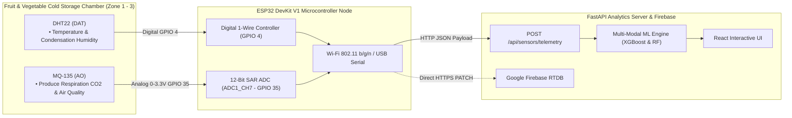

# IoT Hardware Circuit Architecture & Sensor Wiring Specification
## Component 3: Multi-Modal Food Spoilage & Cold Storage Monitoring Node (Fruits & Vegetables)
**Researcher**: Maddumage M. S. (IT23348820)  
**Project**: AI & IoT-Based Smart Restaurant Management System (`J26-IT-333`)  
**Institution**: Sri Lanka Institute of Information Technology (SLIIT) - Faculty of Computing  

---

## 1. Hardware Architecture Overview

In Component 3, the IoT sensing node continuously samples the micro-climate inside restaurant commercial cold storage chambers (walk-in chillers, reach-in freezers, and produce crispers). The collected telemetric stream is pre-processed on an edge microcontroller and transmitted wirelessly via Wi-Fi (HTTP REST / JSON) or over USB UART to the central FastAPI analytics backend.

---

## 2. Active Implementation Bill of Materials (BOM)

| Item # | Component Name | Model / Specification | Purpose in Fruit & Vegetable Monitoring | Operating Voltage | Interface |
| :--- | :--- | :--- | :--- | :--- | :--- |
| **1** | **Microcontroller** | ESP32 DevKit V1 (30-Pin) | 240MHz dual-core processing, 12-bit ADC, JSON serialization | 5.0V (VIN) / 3.3V (Logic) | Micro-USB / 2.4GHz Wi-Fi |
| **2** | **Temp & Humidity Sensor** | DHT22 / AM2302 (3-pin module) | Monitored to prevent chilling injury and mold condensation (*Botrytis cinerea*) | 3.3V | 1-Wire Digital (**GPIO 4**) |
| **3** | **CO₂ & Respiration Sensor** | MQ-135 ($\text{SnO}_2$ sensor) | Measures cellular respiration rate and aerobic/anaerobic breakdown | 5.0V (Heater), 3.3V (AO) | Analog ADC1_CH7 (**GPIO 35**) |
| **4** | **Voltage Divider Resistors** | $10\,\text{k}\Omega$ and $20\,\text{k}\Omega$ ($1\%$) | Steps down MQ-135 5V AO to safe $0 - 3.3\,\text{V}$ for ESP32 ADC | N/A | Passive |
| **5** | **Breadboard & Jumpers** | 830-Point Solderless Breadboard | Interconnects ESP32 and sensor modules | N/A | Prototyping |
| **6** | **Power Supply** | 5V 2.0A DC Adaptor / USB Cable | Powers ESP32 and MQ-135 internal micro-heater ($\approx 150\,\text{mA}$) | 5.0V | USB / DC Rail |

---

## 3. ESP32 Pin Assignment & Connection Table

| Sensor | Sensor Pin Label | ESP32 Target Pin | Signal Type | Electrical Requirement |
| :--- | :--- | :--- | :--- | :--- |
| **DHT22** | **VCC** | **3V3** | DC Power | 3.3V DC rail |
| | **GND** | **GND** | Ground | Common system ground |
| | **DAT** | **GPIO 4 (D4)** | Digital Input | Digital 1-Wire bus (pull-up built into 3-pin PCB) |
| **MQ-135** | **VCC** | **VIN (5V)** | Heater Power | 5V DC (Heater requires $\approx 150\,\text{mA}$) |
| | **GND** | **GND** | Ground | Common system ground |
| | **AO** (Analog Out) | **GPIO 35 (D35)** | Analog Input | Voltage divider ($10\text{k}\Omega / 20\text{k}\Omega$) limits $V_{out} \le 3.3\text{V}$ |
| | **DO** (Digital Out)| *Leave Disconnected*| — | Not required for continuous analog logging |

> [!WARNING]
> **ADC Pin Selection on ESP32**:
> Always use **ADC1** pins (GPIO 32, 33, 34, 35, 36, 39) when using Wi-Fi. **ADC2** pins cannot be used simultaneously when the ESP32 Wi-Fi module is active because the Wi-Fi driver claims ADC2 internally. Our design strictly uses **GPIO 35 (ADC1_CH7)**.

---

## 4. Voltage Divider Calculation for MQ-135 Analog Pin

The MQ-135 gas sensor is powered by $5.0\,\text{V}$ to operate its internal micro-ceramic heating coils ($V_H$). Under heavy gas concentrations, the analog output $V_{AO}$ can reach up to $4.8\,\text{V}$. However, the ESP32 ADC inputs will be damaged if subjected to voltages $> 3.6\,\text{V}$.

To step down $5.0\,\text{V}$ to the safe ESP32 range ($0 - 3.3\,\text{V}$):
$$V_{ADC} = V_{AO} \times \left( \frac{R_2}{R_1 + R_2} \right)$$
Using standard resistors:
- $R_1 = 10\,\text{k}\Omega$ (between MQ-135 AO and ESP32 GPIO 35)
- $R_2 = 20\,\text{k}\Omega$ (between ESP32 GPIO 35 and GND)
$$\text{Division Factor} = \frac{20}{10 + 20} = \frac{2}{3} \approx 0.667$$
Maximum voltage applied to ESP32 pin:
$$V_{ADC\_max} = 5.0\,\text{V} \times 0.667 = 3.33\,\text{V} \le 3.3\,\text{V} \quad \text{(Safe)}$$

---

## 5. Respiration Gas Modeling & Calibration

The MQ-135 sensing element is Tin Dioxide ($\text{SnO}_2$). In clean air, donor electrons are trapped by adsorbed oxygen ions, resulting in high internal resistance ($R_0$). When reducing respiration gases interact with the heated surface, electrons are released back into the conduction band, reducing sensor resistance ($R_s$).

### Step 1: Internal Sensor Resistance ($R_s$)
$$R_s = \left(\frac{V_{in} - V_{out}}{V_{out}}\right) \times R_L$$
Where:
- $V_{in} = 3.30\,\text{V}$ (ADC reference voltage)
- $V_{out} = \text{Measured ADC Voltage}$
- $R_L = 10.0\,\text{k}\Omega$ (Load resistance on the breakout board)

### Step 2: Concentration in PPM via Power-Law Regression
From manufacturer sensitivity log-log curves:
$$\text{ppm} = a \times \left(\frac{R_s}{R_0}\right)^b$$
- For **MQ-135** ($\text{CO}_2$ / Respiration): $a = 116.6$, $b = -2.769$
- Clean air reference baseline: $R_0 \approx 18.2\,\text{k}\Omega$
