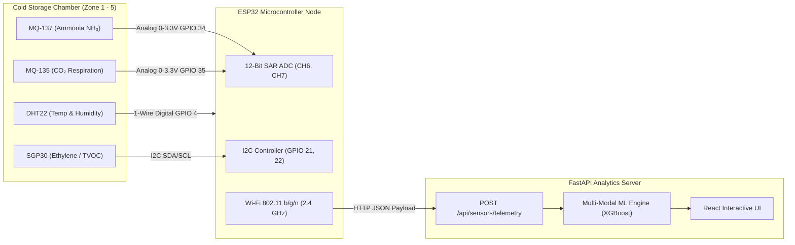

# IoT Hardware Circuit Architecture & Sensor Wiring Specification
## Component 3: Multi-Modal Food Spoilage & Cold Storage Monitoring Node
**Researcher**: Maddumage M. S. (IT23348820)  
**Project**: AI & IoT-Based Smart Restaurant Management System (`J26-IT-333`)  
**Institution**: Sri Lanka Institute of Information Technology (SLIIT) - Faculty of Computing  

---

## 1. Hardware Architecture Overview

The Component 3 IoT sensing node continuously samples the micro-climate inside restaurant commercial cold storage chambers (walk-in chillers, reach-in freezers, and dry preservation bins). The collected telemetric stream is pre-processed on an edge microcontroller and transmitted wirelessly via Wi-Fi (HTTP REST / JSON) to the central FastAPI analytics backend.

---

## 2. Complete Component Bill of Materials (BOM)

| Item # | Component Name | Model / Specification | Purpose in Component 3 | Operating Voltage | Interface |
| :--- | :--- | :--- | :--- | :--- | :--- |
| **1** | **Microcontroller** | ESP32 DevKit V1 (30-Pin) | Edge processing, ADC conversion, Wi-Fi telemetry dispatch | 5.0V (VIN) / 3.3V (Logic) | Micro-USB / Wi-Fi |
| **2** | **Temp & Humidity Sensor** | DHT22 / AM2302 | Tracks storage thermal stability and relative humidity condensation | 3.3V – 5.0V | 1-Wire Digital (GPIO 4) |
| **3** | **Ammonia Sensor** | MQ-137 (Tin Dioxide $SnO_2$) | Detects protein deamination & bacterial decomposition in seafood/meat | 5.0V (Heater), 3.3V (Out) | Analog ADC1_CH6 (GPIO 34) |
| **4** | **Air Quality / CO₂ Sensor** | MQ-135 ($SnO_2$ semiconductor) | Measures anaerobic respiration spikes and mold germination emissions | 5.0V (Heater), 3.3V (Out) | Analog ADC1_CH7 (GPIO 35) |
| **5** | **Ethylene / VOC Sensor** | SGP30 (Sensirion Multi-Pixel) | Measures climacteric ripening gas (ethylene $\text{C}_2\text{H}_4$) and total VOCs | 3.3V | $\text{I}^2\text{C}$ (GPIO 21 / 22) |
| **6** | **Pull-Up Resistor** | $4.7\,\text{k}\Omega$ Metal Film | Required for DHT22 digital data bus pull-up | N/A | Passive |
| **7** | **Voltage Divider Resistors** | $10\,\text{k}\Omega$ and $20\,\text{k}\Omega$ ($1\%$) | Converts 5V analog outputs of MQ sensors to $\le 3.3\text{V}$ safe for ESP32 ADC | N/A | Passive |
| **8** | **Breadboard & Jumpers** | 830-Point Solderless Breadboard | Rapid prototyping & testing | N/A | Prototyping |
| **9** | **Power Supply** | 5V 2.0A DC Adaptor / USB Power Bank | Powers ESP32 and heater coils ($>800\,\text{mA}$) | 5.0V | DC Barrel / USB |

---

## 3. ESP32 Pin Assignment & Connection Table

| Sensor Pin | Sensor Name | ESP32 Target Pin | Signal Type | Electrical Requirement |
| :--- | :--- | :--- | :--- | :--- |
| **Pin 1 (VCC)** | DHT22 | **3V3** | DC Power | 3.3V DC rail |
| **Pin 2 (DATA)**| DHT22 | **GPIO 4** | Digital Input | $4.7\,\text{k}\Omega$ pull-up resistor to 3V3 |
| **Pin 4 (GND)** | DHT22 | **GND** | Ground | Common system ground |
| **VCC** | MQ-137 | **VIN (5V)** | Heater Power | 5V DC (Heater requires $\approx 150\,\text{mA}$) |
| **GND** | MQ-137 | **GND** | Ground | Common system ground |
| **AOUT** | MQ-137 | **GPIO 34 (ADC1_CH6)** | Analog Input | Voltage divider to limit $V_{out} \le 3.3\text{V}$ |
| **VCC** | MQ-135 | **VIN (5V)** | Heater Power | 5V DC (Heater requires $\approx 150\,\text{mA}$) |
| **GND** | MQ-135 | **GND** | Ground | Common system ground |
| **AOUT** | MQ-135 | **GPIO 35 (ADC1_CH7)** | Analog Input | Voltage divider to limit $V_{out} \le 3.3\text{V}$ |
| **VCC** | SGP30 | **3V3** | DC Power | 3.3V DC |
| **GND** | SGP30 | **GND** | Ground | Common system ground |
| **SDA** | SGP30 | **GPIO 21** | $\text{I}^2\text{C}$ Data | Built-in pull-ups enabled |
| **SCL** | SGP30 | **GPIO 22** | $\text{I}^2\text{C}$ Clock| Built-in pull-ups enabled |

> [!WARNING]
> **ADC Pin Selection on ESP32**:
> Always use **ADC1** pins (GPIO 32, 33, 34, 35, 36, 39) when using Wi-Fi. **ADC2** pins cannot be used simultaneously when the ESP32 Wi-Fi module is active because the Wi-Fi driver claims ADC2 internally! Our design strictly uses **GPIO 34 (ADC1_CH6)** and **GPIO 35 (ADC1_CH7)**.

---

## 4. Voltage Divider Calculation for MQ Analog Pins

The MQ-series gas sensors are powered by $5.0\,\text{V}$ to operate their internal micro-ceramic heating coils ($V_H$). Under heavy gas concentrations, the analog output $V_{AOUT}$ can reach up to $4.8\,\text{V}$. However, the ESP32 ADC inputs will be damaged if subjected to voltages $> 3.6\,\text{V}$.

To step down $5.0\,\text{V}$ to the safe ESP32 range ($0 - 3.3\,\text{V}$):
$$V_{ADC} = V_{AOUT} \times \left( \frac{R_2}{R_1 + R_2} \right)$$
Using standard resistors:
- $R_1 = 10\,\text{k}\Omega$
- $R_2 = 20\,\text{k}\Omega$
$$\text{Division Factor} = \frac{20}{10 + 20} = \frac{2}{3} \approx 0.667$$
Maximum voltage applied to ESP32 pin:
$$V_{ADC\_max} = 5.0\,\text{V} \times 0.667 = 3.33\,\text{V} \le 3.3\,\text{V} \quad \text{(Safe)}$$

---

## 5. Gas Resistance ($R_s/R_0$) and PPM Conversion Mathematical Modeling

The MQ sensor's sensing element is Tin Dioxide ($\text{SnO}_2$). In clean air, donor electrons are trapped by adsorbed oxygen ions, resulting in high internal resistance ($R_0$). When reducing gases (Ammonia, Ethanol, Carbon Monoxide) interact with the heated surface, electrons are released back into the conduction band, reducing sensor resistance ($R_s$).

### Step 1: Internal Sensor Resistance ($R_s$) Formula
$$R_s = \left(\frac{V_{in} - V_{out}}{V_{out}}\right) \times R_L$$
Where:
- $V_{in} = 3.30\,\text{V}$ (ADC reference voltage)
- $V_{out} = \text{Measured ADC Voltage}$
- $R_L = 10.0\,\text{k}\Omega$ (Load resistance on the breakout board)

### Step 2: Concentration in PPM via Power-Law Regression
From manufacturer sensitivity log-log curves:
$$\log(\text{ppm}) = \log(a) + b \cdot \log\left(\frac{R_s}{R_0}\right)$$
$$\text{ppm} = a \times \left(\frac{R_s}{R_0}\right)^b$$
- For **MQ-137** (Ammonia $\text{NH}_3$): $a = 102.2$, $b = -2.473$
- For **MQ-135** ($\text{CO}_2$ / Air Quality): $a = 116.6$, $b = -2.769$

---

## 6. Sensor Calibration Protocol (Burn-In & Zero-Offset)
1. **Initial Burn-In (Preheat) Phase**:
   - New MQ sensors require **24 to 48 hours of continuous heating** at $5.0\,\text{V}$ prior to taking experimental measurements to purge atmospheric volatile contaminants from the tin dioxide layer.
2. **Clean Air $R_0$ Calibration**:
   - Expose the preheated sensor to clean ambient outdoor air ($25^\circ\text{C}$, $60\%$ RH).
   - Read $R_s$ and assign $R_0 = R_s / \text{CleanAirRatio}$ (where $\text{CleanAirRatio} \approx 3.6$ for MQ-135 and $\approx 1.0$ for MQ-137).
3. **Temperature & Humidity Compensation**:
   - The sensor response shifts with ambient humidity. The firmware factors in DHT22 humidity to apply compensation polynomials.
